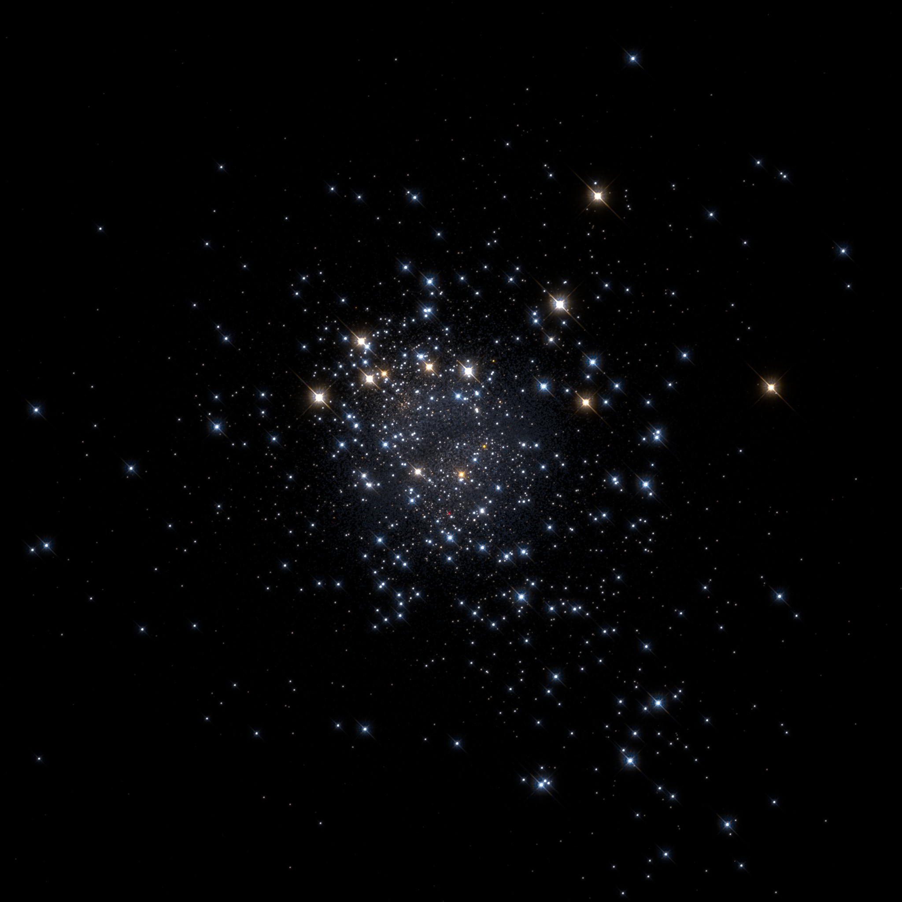

# Fresco
Fresco aims to simulate observations of particle-based simulations, such as
those of a star cluster. It creates an observation-like image from a list of
stars and/or gas particles. Supported filetypes include AMUSE-type hdf5 files,
Starlab files and plaintext files.

For stars, the temperature and radius are calculated using a stellar evolution
code, if these are not already present in the dataset.

Gas particles may also be read. In combination with stars, these will cause
reflection from nearby stars and optionally extinction of light from
background. Without stars, Fresco will make a density plot of the gas.
Optionally, the gas may also be indicated with contour lines.

A random field of background and foreground stars may be added to the image, as
a way to make the image more natural looking and/or to provide a background
that may be obscured by the gas/dust particles.

## Requirements

-   Python 3.7 or higher
-   Numpy
-   Scipy
-   Matplotlib
-   AMUSE (https://github.com/amusecode/amuse)
    -   a stellar evolution code (e.g. SSE or SeBa, for calculating stellar luminosities and radii)
    -   optional: Fi (for calculating dust extinction)
-   Astropy
-   amuse-masc (recommended)

## Usage
    import matplotlib.pyplot as plt
    from amuse.datamodel import Particles
    from amuse.units import units, nbody_system
    from amuse.community.sse import Sse
    from amuse.ic.plummer import new_plummer_sphere
    from amuse.ic.kroupa import new_kroupa_mass_distribution
    from amuse_fresco import make_fresco_image
    ?make_fresco_image  # Show options
    stars_mass = new_kroupa_mass_distribution(1024)
    stars = new_plummer_sphere(1024, nbody_system.nbody_to_si(stars_mass.sum(), 3 | units.pc))
    stars.mass = stars_mass
    gas = Particles()
    se = Sse()
    se.particles.add_particles(stars)
    from_se = se.particles.new_channel_to(stars)
    from_se.copy()
    images, vmax = make_fresco_image(
        stars=stars,
        gas=gas,
        mode=["stars"],
        return_vmax=True,
    )
    plt.imshow(images[0])
    plt.show()

## Authors

Fresco is developed by Steven Rieder and was started by Inti Pelupessy
